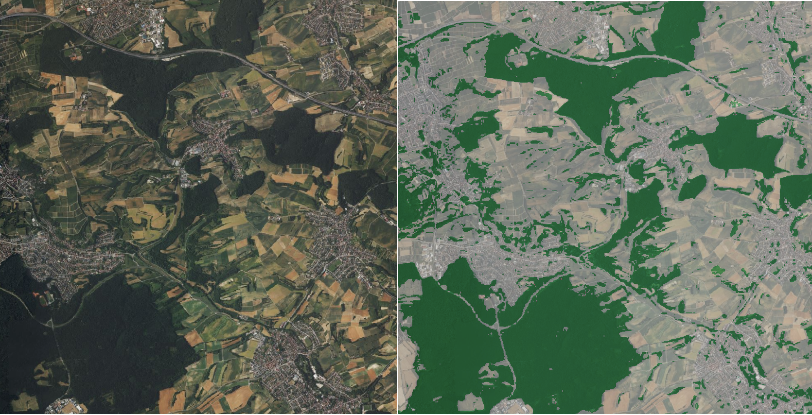

# Sentinel-2 Forest Detection (Machine Learning)

This repository contains a machine learning pipeline (Random Forest) for the automatic detection of forest areas in Sentinel-2 L2A satellite imagery. The algorithm uses a pixel-based approach utilizing optical bands (Blue, Green, Red) as well as Near Infrared (NIR) and the calculated NDVI.

###  Key Results
* **Accuracy:** ~95.8% on the test dataset.
* **Most important features:** Blue Band (B02) and Red Band (B04).

<p align="center">
  
</p>
*Left: Raw Satellite RGB image | Right: Predicted Forest Mask (Green)*

## 📂 Project Structure

```text
├── config.yaml          # Central configuration file (paths, hyperparameters)
├── requirements.txt     # Required Python libraries
├── .gitignore           # Ignores data/ and __pycache__/ folders
├── README.md            # This documentation
├── data/                # (gitignored) User must provide this data locally
│   ├── raw/             # Sentinel-2 bands (B02, B03, B04, B08 as .jp2)
│   ├── interim/         # Ground truth data (labels.gpkg) and extracted pixels (CSV)
│   └── processed/       # Trained model (.pkl) and final result (forest_mask.tif)
└── src/
    ├── preprocess.py    # Extracts pixel values beneath the ground truth polygons
    ├── train.py         # Trains the Random Forest model (train/test split)
    └── predict.py       # Applies the model to the entire satellite image

## 🚀 Installation

1. Clone this repository.
2. Create a virtual environment (e.g., using Conda or venv) and activate it.
3. Install the required dependencies:

## 🛠️ Workflow & Execution

### Step 1: Data Preparation
1. Download a Sentinel-2 L2A scene.
2. Copy the 10m resolution bands (B02, B03, B04, B08) into the `data/raw/` directory (format: T32UMV_20...9_B02_10m).
3. Create a GeoPackage (`data/interim/trainingsdata.gpkg`) in QGIS containing polygons for your training data. Create a column (e.g., `class_id`) where forest areas are assigned the value `1` and non-forest areas the value `0`.

### Step 2: Configuration
Check the `config.yaml` in the root directory. Make sure the layer name of the GeoPackage and the column name for the labels (e.g., `class_id`) are entered correctly.

### Step 3: Preprocessing (Extracting Pixels)
This script reads the Sentinel-2 bands and extracts the pixels located under your drawn polygons. The extracted values (including NDVI) are saved as `training_data.csv` in `data/interim/`.


### Step 4: Model Training
This script splits the extracted pixels into training and test datasets (80/20), trains a Random Forest Classifier, and evaluates the accuracy. The trained model is saved in `data/processed/`.


### Step 5: Prediction
The trained model is applied to the entire satellite image. The result is a final classification map (`forest_mask.tif`) where each pixel is either 1 (forest) or 0 (non-forest).
*(Note: This process is computationally intensive and may take a few minutes).*


#
